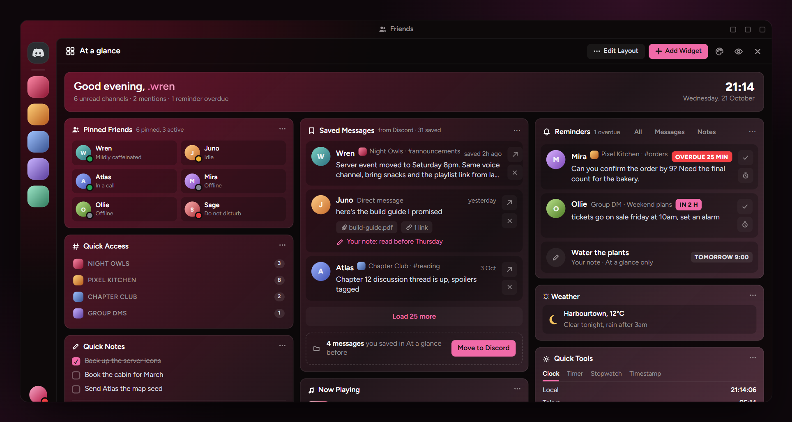
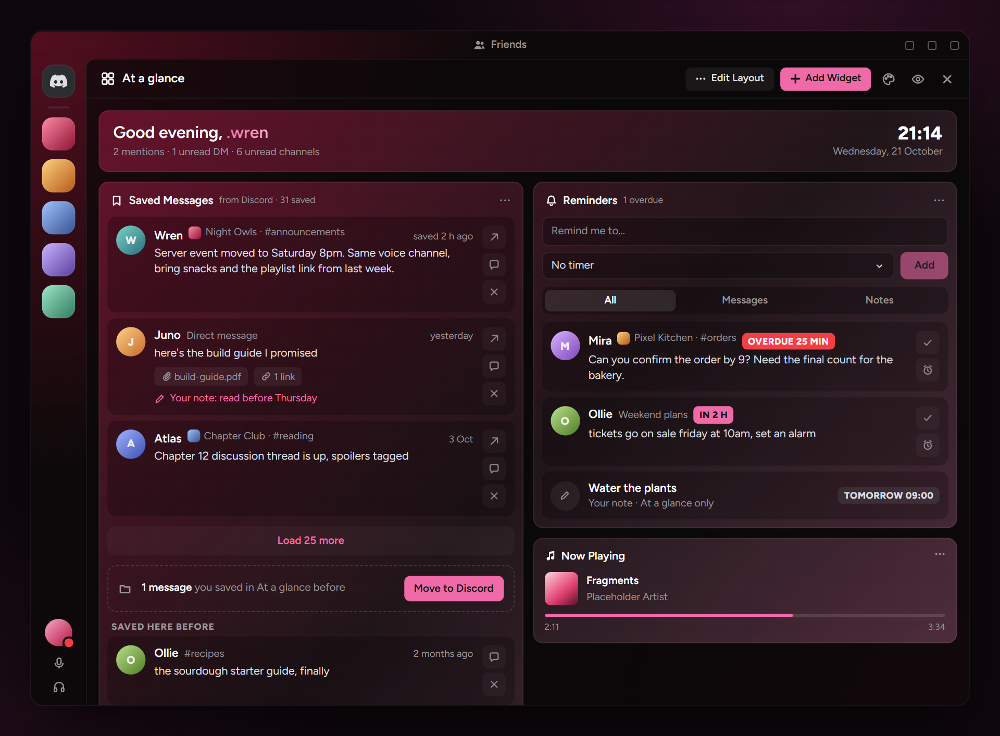

<div align="center">


**A customizable overview page for Discord, one tab above your Friends button.**

[](CHANGELOG.md)
[](https://vencord.dev)
[](#install)
[](LICENSE)

[Install](#install) · [Widgets](#widgets) · [Setup guide](SETUP.md) · [Orion add-on](#orion-add-on-optional) · [Changelog](CHANGELOG.md)

</div>

---

Pinned friends, watched channels, your inbox, quick tools and integrations, all on
one page that is part of Discord's own layout, not a window floating over it. The
server rail keeps working, the title bar and notice bar stay above it, Discord's
theme editor docks beside it, and everything is built on Discord's real internals:
native message rendering, native pickers, native send pipeline.



## Highlights

- **Quick chat popups.** Open any DM or channel in a centred popup with full chat
  functionality: replies, reactions, inline editing, GIF/emoji/sticker pickers,
  `:emoji` and `@mention`/`@role` autocomplete, a formatting toolbar, native-style
  message grouping and a "new messages" bar when you're scrolled up.
- **A free layout.** Up to three columns, and any widget can drag into any of
  them - the column a widget lands in is saved per account, not fixed by what
  kind of widget it is. Friends drag into your own order, server sections drag
  and collapse, all of it persisting the same way.
- **Theme-proof and yours.** Surfaces and inks adapt to light and dark themes
  automatically, Nitro gradients included. Three materials (classic, acrylic, glass)
  and one-click colour presets (Nord, Dracula, Catppuccin and more) at subtle,
  tasteful intensities - the background is entirely yours to set, solid by default.
- **Your nameplate, everywhere.** The bottom-left user area wraps your Nitro
  nameplate around the whole strip, fading up into the sidebar.
- **Privacy blur.** One button in the top bar blurs pinned friends, server names
  and your weather location for a screen share or a screenshot. Everything stays
  clickable while it's on, and it clears itself when you close the dashboard.
  Presentation cover rather than redaction - the text is still in the page.
- **Discord's own saves.** Saved Messages and Reminders read your Discord
  bookmarks and reminders, so they follow your account to every device. Bookmark
  or set a reminder from Discord's own message menu and it shows up here, tidied
  into neat rows. Text reminders that aren't tied to a message stay alongside them.
- **Honest security posture.** Three small webpack patches, one external host
  (Open-Meteo for weather), validated storage that a failed load can't overwrite, no
  eval, no token access, no automated API activity. Re-audited at v2.6.3 with no
  security findings - details in [SECURITY.md](SECURITY.md).

## Widgets

| Widget | What it does |
| --- | --- |
| **Pinned Friends** | Presence, live activity, DM mention badges, a pinned/active count in the header. Click for quick chat; right-click for profile, call, notes, nicknames, block and more. Two per row, drag to reorder; Show more beyond the first ten. |
| **Inbox** | Two tabs: **Mentions** (Discord's recent-mentions inbox) and **Direct Messages** (every unread DM with avatar, preview and badge). Mark all read per tab. |
| **Quick Access Channels** | Watched channels grouped per server with collapsible headers that carry their own mention badge / unread dot, text channels listed above voice. Voice rows show live occupants while collapsed; double-click joins. Pinned group DMs get their own avatar; opening its chat is a click, starting (or joining) the call is a double-click, and Enter/Space still expands the row to see who's in the call. |
| **Quick chat popup** | The centred chat card described above. Quick reactions drawn from your own emoji, clicking a reply jumps straight to it, per-channel scroll memory, unread NEW divider, viewing acks the channel like a real view. |
| **Quick Tools** | One tab at a time: Clock (add and manage world clock zones right in the tab), Timer (hours/minutes/seconds, survives a restart), Stopwatch (laps, survives a restart), Calculator, and Timestamp builder. Remembers your last tool. |
| **Weather** | Open-Meteo weather with location search, 4-day forecast, your own refresh interval and a last-updated line. |
| **Now Playing** | Read-only listening status from Discord's local store, following any music platform Discord can see a listening activity for (not just Spotify). Hides itself by default when nothing is playing. |
| **Quick Notes** | Structured notes with bullets, clickable checkboxes and dividers. |
| **Events** | Upcoming scheduled events rolled up per server, with RSVP and one-click join when live. |
| **Saved Messages** | Discord's own bookmarks, synced across your devices: bookmark with Discord's Bookmark Message, and each row shows who, where, when, a tidy two-line preview, file and link chips and your note. Click jumps straight to the message. Saves made in older versions sit under "Saved here before" until you press **Move to Discord**. |
| **Reminders** | Discord's message reminders and your own text reminders in one list, ordered by due time with overdue first. Filter by All, Messages or Notes, and mark a Discord reminder done or snooze it straight from its row. Discord sends its own notification for those, so you only ever get one. |
| **Client Performance** | Renderer JS-heap and UI latency. Only metrics the renderer can honestly measure. |
| **Orion** _(optional, off by default)_ | Remote control for the separate OrionQuests plugin: status pill, Start / Stop / Status buttons, live per-quest progress. Enable it under **Add Widget**; inert unless OrionQuests is also installed. |

There's also a command palette (default `Shift+Space`), a quick-pin hotkey
(default `Ctrl+Shift+P`), a greeting header that counts your mentions, unread DMs
and channels - click the summary to open a notification panel with per-item
dismiss and "Mark all read" - and an optional open-on-startup mode.



## Orion add-on (optional)

At a glance ships an optional **Orion** widget: a remote control for a **separate**
plugin called **OrionQuests**, which auto-completes Discord Quests. The widget is
**hidden by default** and does nothing on its own - it only comes alive if you choose
to install OrionQuests as well, wired up through a small versioned bridge so At a glance
never depends on it.

> [!WARNING]
> **OrionQuests automates your own Discord account.** Automating your account is against
> Discord's Terms of Service, and Discord actively enforces against quest automation:
> using it **can get your account limited or banned**. It is a separate, opt-in plugin -
> **not bundled with At a glance and off by default** - and installing it is entirely
> your own decision and risk. If in doubt, leave it out; everything else works without it.

Setup is in the [setup guide](SETUP.md#part-2-optional-add-the-orion-quest-widget), which
leads with the same warning. Once OrionQuests is installed and enabled, tick **Orion**
under **Add Widget** to get a status pill and Start / Stop / Status controls.

## Install

At a glance is a **userplugin**, compiled into the client mod from source. It runs
unchanged on **[Vencord](https://vencord.dev)** and its fork
**[Equicord](https://github.com/Equicord/Equicord)** - both bundle `src/userplugins/`
and share the same plugin APIs, so pick whichever you use.

**On Vencord:**

```console
git clone https://github.com/Vendicated/Vencord
cd Vencord
pnpm install --frozen-lockfile
git clone https://github.com/KayTwoOne/at-a-glance src/userplugins/atAGlance
pnpm build && pnpm inject
```

**On Equicord** (same steps, different repo):

```console
git clone https://github.com/Equicord/Equicord
cd Equicord
pnpm install --frozen-lockfile
git clone https://github.com/KayTwoOne/at-a-glance src/userplugins/atAGlance
pnpm build && pnpm inject
```

Quit Discord fully before `pnpm inject` (tray icon, then Quit). Afterwards enable
**AtAGlance** under Settings → Plugins and restart Discord once more.

**Already running Vencord or Equicord from source with your own plugins?** Just the
`git clone … src/userplugins/atAGlance` line and a rebuild. The full walkthrough,
including multi-plugin setups, updating and troubleshooting, is in
**[SETUP.md](SETUP.md)**.

Dev loop: edit, `pnpm build` (or `pnpm dev` for watch), `Ctrl+R` in Discord.

## Architecture & security

Three small webpack patches, each its own entry, so one failing after a Discord
update costs only its own part. One inserts the sidebar tab (the same anchor
Vencord's own PinDMs uses). One renders the dashboard as a cell of Discord's own
app grid, inside Discord's React tree rather than a separate root, so Discord's
layout places it. One puts a `data-vc-glance-panels` marker on Discord's user
panel so it can be hidden while the dashboard is open, without relying on a
guessed class name. Everything else goes through stable Vencord APIs. Config is
validated and capped on every load (IDs, notes text, weather location, layout
state only) and stored per account in IndexedDB, and nothing is written until
that account's data has loaded. Message sending, blocking, calls, notes and RSVP
all invoke the same action creators Discord's own UI uses - always user-initiated,
never on a timer, so there's no self-bot / rate-limit exposure. Every widget sits
in an error boundary (the injected tab and dashboard host no-op ones), so one
broken internal never takes the page - or Discord - down.

Re-audited at v2.6.3 (2026-07-15) with no security findings: no token access, no
`eval`/`innerHTML`/injection sinks, one opt-in external host (Open-Meteo, pinned
and allowlisted), and balanced listeners/timers that are fully torn down on
disable. Full write-up in **[SECURITY.md](SECURITY.md)**, which also notes what
3.1.0 changed (the layout host and the load and save path) and that those parts
were checked against the code rather than re-audited.

Known limitations live at the bottom of [SETUP.md](SETUP.md#troubleshooting); the
short version is that the popup renders messages outside Discord's full list
context, so it ships its own reply/edit affordances, and a Discord restructure can
temporarily degrade the composer to a minimal fallback.

## License

[GPL-3.0](LICENSE), same as Vencord.
